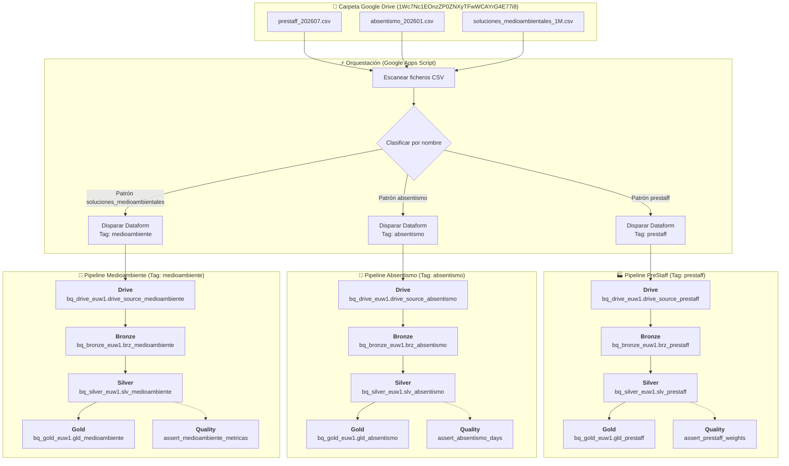

# Dataform - Arquitectura PreStaff (Sandbox)

Arquitectura base de ingeniería de datos y modelado analítico en Google Cloud BigQuery con **Dataform Core 3.0+**, diseñada para la ingesta y transformación selectiva por **Tags de negocio** de ficheros CSV procedentes de **Google Drive** orquestados mediante **Google Apps Script**.

---

## 📌 Datos de Configuración GCP

* **Proyecto GCP único:** `belen-torres-sandbox1`
* **Región BigQuery:** `europe-west1`
* **Carpeta Google Drive Origen:** [`1Wc7Nc1EOnzZP0ZNXyTFwWCAYrG4E77i8`](https://drive.google.com/drive/folders/1Wc7Nc1EOnzZP0ZNXyTFwWCAYrG4E77i8)
* **Versión Dataform Core:** `3.0.0` (configurado exclusivamente mediante [`workflow_settings.yaml`](workflow_settings.yaml), sin `package.json` redundante)

### Datasets por Capa (Arquitectura Medallion)
| Capa | Dataset BigQuery | Descripción | Tipo de Objetos |
| :--- | :--- | :--- | :--- |
| **Drive / Staging** | `bq_drive_euw1` | Ingesta de CSVs de Drive mediante tablas externas | `EXTERNAL TABLE` (DDL) |
| **Bronze** | `bq_bronze_euw1` | Tablas nativas BigQuery basadas directamente en las tablas externas | `TABLE` |
| **Silver** | `bq_silver_euw1` | Histórico, transformaciones de negocio, limpieza y deduplicación | `TABLE (INCREMENTAL)` |
| **Gold** | `bq_gold_euw1` | Modelos analíticos y KPIs agregados, particionados y clusterizados | `TABLE` |
| **Assertions** | `bq_assertions_euw1` | Control de calidad, gobierno y validación de reglas de negocio | `ASSERTION` |

---

## 🏷️ Mapeo de Ficheros CSV a Procesos (Tags)

Apps Script inspecciona los nombres de los archivos CSV depositados en la carpeta de Drive y activa **únicamente** los modelos SQLX de Dataform vinculados al tag correspondiente mediante `invocationConfig.includedTags`:

| Patrón de Fichero | Tag de Dataform | Proceso de Negocio | Acciones Dataform Involucradas |
| :--- | :--- | :--- | :--- |
| `prestaff_*.csv` | `prestaff` | Personal, turnos y operaciones PreStaff | `drive_source_prestaff` ➔ `brz_prestaff` ➔ `slv_prestaff` ➔ `gld_prestaff` |
| `absentismo_*.csv` | `absentismo` | Recursos Humanos, bajas y horas de ausencia | `drive_source_absentismo` ➔ `brz_absentismo` ➔ `slv_absentismo` ➔ `gld_absentismo` |
| `soluciones_medioambientales_*.csv` | `medioambiente` | Proyectos de sostenibilidad, reducción de CO2 e impacto ambiental | `drive_source_medioambiente` ➔ `brz_medioambiente` ➔ `slv_medioambiente` ➔ `gld_medioambiente` |

> [!NOTE]
> Si en la carpeta solo entra un archivo como `prestaff_202607.csv`, Dataform solo compilará y ejecutará las transformaciones del tag `prestaff`. Los modelos de `absentismo` o `medioambiente` no se ejecutan, garantizando total independencia, ahorro de costes de computación y cero colisiones.

---

## 🏛️ Diagrama del Flujo de Datos



---

## 📂 Estructura del Repositorio

```text
├── workflow_settings.yaml             # Configuración de Dataform Core 3.0 (belen-torres-sandbox1, europe-west1)
├── README.md                          # Documentación del proyecto y guías de ejecución
├── .editorconfig                      # Reglas de formato homogéneo de código
├── .gitignore                         # Exclusiones de Git (temporales, claves, logs)
├── includes/
│   ├── constants.js                   # Constantes globales, mapeo de datasets y catálogo de TAGS
│   ├── helpers.js                     # Macros: getFilesForTag, surrogateKey (SHA256), auditColumns, driveUri
│   └── docs.js                        # Diccionario de datos centralizado para documentación de columnas
├── definitions/
│   ├── sources/
│   │   ├── drive_source_prestaff.sqlx          # DDL external tables CSVs PreStaff (Tag: prestaff)
│   │   ├── drive_source_absentismo.sqlx        # DDL external tables CSVs Absentismo (Tag: absentismo)
│   │   └── drive_source_medioambiente.sqlx     # DDL external tables CSVs Medioambiente (Tag: medioambiente)
│   ├── output/
│   │   ├── bronze/
│   │   │   ├── brz_prestaff.sqlx               # Bronze: tabla nativa BigQuery (Tag: prestaff)
│   │   │   ├── brz_absentismo.sqlx             # Bronze: tabla nativa BigQuery (Tag: absentismo)
│   │   │   └── brz_medioambiente.sqlx          # Bronze: tabla nativa BigQuery (Tag: medioambiente)
│   │   ├── silver/
│   │   │   ├── slv_prestaff.sqlx               # Silver: histórico deduplicado con SHA256 surrogate key (Tag: prestaff)
│   │   │   ├── slv_absentismo.sqlx             # Silver: ausencias deduplicadas con surrogate key (Tag: absentismo)
│   │   │   └── slv_medioambiente.sqlx          # Silver: proyectos deduplicados con surrogate key (Tag: medioambiente)
│   │   └── gold/
│   │       ├── gld_prestaff.sqlx               # Gold: KPIs diarios (Tag: prestaff)
│   │       ├── gld_absentismo.sqlx             # Gold: KPIs mensuales de bajas por departamento (Tag: absentismo)
│   │       └── gld_medioambiente.sqlx          # Gold: KPIs mensuales de inversión e impacto ambiental (Tag: medioambiente)
│   └── assertions/
│       ├── assert_prestaff_weights.sqlx        # Control de calidad: pesos netos no negativos (Tag: prestaff)
│       ├── assert_absentismo_days.sqlx         # Control de calidad: días de baja no negativos (Tag: absentismo)
│       └── assert_medioambiente_metricas.sqlx  # Control de calidad: costes, CO2 e índice válidos (Tag: medioambiente)
```

---

## 🔄 Cómo Añadir un Nuevo Proceso de Negocio

Si en el futuro se añade un nuevo tipo de fichero (ejemplo: `facturacion_*.csv`):

1. **Crear los modelos SQLX** con el tag `tags: ["facturacion"]`:
   * `definitions/sources/drive_source_facturacion.sqlx` (`helpers.getFilesForTag("facturacion")`)
   * `definitions/output/bronze/brz_facturacion.sqlx`
   * `definitions/output/silver/slv_facturacion.sqlx`
   * `definitions/output/gold/gld_facturacion.sqlx`
2. **Invocar desde Apps Script** enviando los ficheros en `archivos_json` y ejecutando el tag `includedTags: ["facturacion"]`. Dataform cargará la tabla externa en `bq_drive_euw1` y ejecutará todo el pipeline automáticamente.
